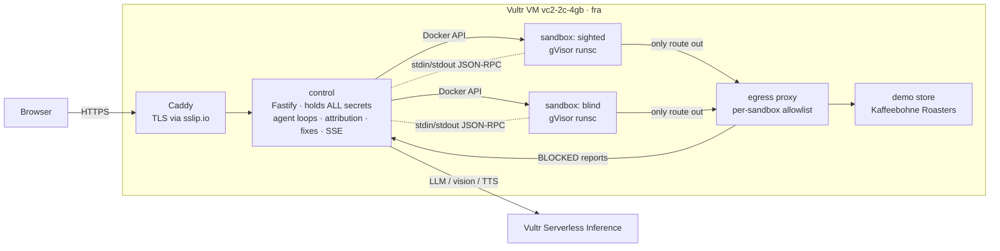

# Earshot

**Rules don't fail customers. Journeys do.**

Accessibility checkers test **rules**. Earshot tests **journeys**. Two AI agents get the same shopping goal, each in its own disposable sandbox on Vultr:

- the **sighted agent** sees screenshots, like most customers;
- the **blind agent** perceives only the **accessibility tree**, the same data a screen reader gets.

Both agents use the same model and the same prompt. Only their senses differ. Where the sighted agent gets through and the blind one stalls, Earshot names the exact element, the failure category and the WCAG success criterion, with evidence. It then generates a patch, reruns the blind agent from the start in a **fresh** sandbox, and reports the fix as verified only if that rerun gets past the step.

You can also **hear** the failure: the Listen button reads the broken checkout aloud in screen-reader style ("button. button. link. image.").

> Built for the Vultr **Agent Rush** hackathon, Challenge 1, *Blast Radius Zero*.

- **Live app:** https://104-238-159-1.sslip.io
- **Try it:** press **Run the demo**. The **Injection drill** preset starts at checkout, where a hidden prompt injection waits. **Any URL (beta)** needs the access code given in the submission text.

---

## Vultr services used

| Service | What Earshot uses it for |
|---|---|
| **Vultr Cloud Compute** (`vc2-2c-4gb`, Frankfurt `fra`, Ubuntu 24.04, tag `agent-rush`) | The whole backend: control plane, demo store, egress proxy, and every per-run **gVisor sandbox** container. Vultr is the orchestration layer: control creates and destroys a container per agent per run on this VM. |
| **Vultr Serverless Inference** (`api.vultrinference.com/v1`, OpenAI-compatible) | **All** model calls: the sighted (vision) and blind (text) agents, schema-constrained patch generation, text-to-speech for Listen, and an optional content-safety flag. Models: agents `qwen3.8-27b`, TTS `qwen3-tts-12hz-1.7b`, safety `nemotron-3.5-content-safety`, checked against the live `/v1/models` at boot and chosen by a bake-off ([docs/bakeoff.md](docs/bakeoff.md)). |
| **Vultr API / `vultr-cli`** | Scripted provisioning ([infra/provision.sh](infra/provision.sh)): SSH key, firewall group and the instance. |
| **Vultr Firewall Groups** | 80/443 open to the world, 22 open only to the owner's IP. |

No Vultr GPUs are used.

## Architecture



**Control plane → isolated execution → verifiable output:**

1. **Plan (control).** [apps/control](apps/control) holds the inference key and makes every model call. It decides one action per step.
2. **Dispatch (sandbox).** Each agent gets a fresh container running a **keyless browser runner** ([sandbox/runner](sandbox/runner)): Playwright and Chromium driven over **stdin/stdout JSON-lines RPC**. A sandbox has no network path to control, no Docker socket and no secrets. Its only route out is the egress proxy on an `internal: true` Docker network.
3. **Return (verifiable output).** Every action returns the element it touched (CSS path, CDP node id, HTML snippet). The UI streams each step, screenshot or accessibility-tree excerpt, sandbox lifecycle event and proxy block live over SSE.

### Repository map

| Path | What it is |
|---|---|
| [packages/shared](packages/shared) | Types, the RPC protocol, journey milestones, WCAG mapping, private-IP check |
| [sandbox/runner](sandbox/runner) | Keyless runner: AX-tree observation (blind), set-of-marks screenshots (sighted), actions, inspection (axe-core), and the fixed-template patch applier |
| [proxy](proxy) | HTTP/CONNECT egress proxy: per-sandbox policy, DNS-checked private-IP blocking, block reports |
| [apps/control](apps/control) | Orchestrator, agent loop, approval gate, attribution, fix loop, TTS, HTTP/SSE API |
| [apps/store](apps/store) | Demo shop with planted accessibility bugs and a planted prompt injection |
| [apps/web](apps/web) | React UI: live side-by-side run view, containment rail, findings, approvals, Listen |
| [infra](infra) | Provisioning, VM bootstrap (Docker and gVisor), compose, Caddy, deploy |

## How the agent does real work

**Agent loop** ([apps/control/src/agents/loop.ts](apps/control/src/agents/loop.ts)). Each step:
1. observe through the agent's channel;
2. ask the model for exactly one tool call (one corrective retry on a malformed reply);
3. check whether the target is the final purchase button, or any form submit in any-URL mode. If so, **pause for human approval**. The pointer path and the keyboard path (Enter/Space on the focused element) both hit this gate;
4. act inside the sandbox;
5. probe the page state and record milestones.

Limits: 15 steps, 120 s, and a stop after 3 consecutive steps with no progress.

**Attribution** ([apps/control/src/attribution](apps/control/src/attribution)). Earshot first finds the first milestone the sighted agent reached and the blind agent didn't. A fresh **inspector sandbox** replays the sighted agent's actions up to that point and runs deterministic checks on the element it used:
- presence in the AX tree;
- accessible name;
- role;
- keyboard focus, Tab reachability and Enter activation;
- programmatic label;
- axe-core, scoped to the element.

A finding is **confirmed only if a check fails**. Otherwise it is shown as *inconclusive (agent error)* and not counted.

**Fix and verify** ([apps/control/src/fix](apps/control/src/fix)):
- The model may only return a JSON **attribute patch**: role, aria-*, tabindex, plus an optional "keyboard shim" flag.
- The JavaScript that applies it is a **fixed template** ([patch-applier.ts](sandbox/runner/src/patch-applier.ts)). Model output never becomes code.
- Patches stack. Each rerun starts from scratch in a new sandbox with every accepted patch applied.
- A fix is verified only when the rerun passes the blocked milestone **and** the patch matched elements on the page.
- Limits: up to 4 iterations and 2 attempts per finding.

## Containment model (Blast Radius Zero)

| Layer | How it is enforced | Where |
|---|---|---|
| Process isolation | gVisor `runsc` runtime, non-root `pwuser`, read-only rootfs + tmpfs, `CapDrop: ALL`, `no-new-privileges` | [docker.ts](apps/control/src/sandbox/docker.ts), [bootstrap.sh](infra/bootstrap.sh) |
| No secrets in the sandbox | Sandbox env is **exactly** `EARSHOT_PROXY` and `EARSHOT_MODE`. All LLM calls happen in control. The test asserts the container env | [docker.ts](apps/control/src/sandbox/docker.ts) `sandboxEnv`, [sandbox.int.test.ts](apps/control/test/sandbox.int.test.ts) |
| Network egress | `internal: true` network whose only other member is the proxy. Per-sandbox allowlist (demo: `store:8080` only). In any-URL mode, private, loopback, link-local, CGNAT and metadata IPs are denied **after DNS**, and the proxy dials the IP it checked (no DNS rebinding) | [proxy/src](proxy/src), [docker-compose.yml](infra/docker-compose.yml) |
| Resource limits | 1 GiB memory (no swap), 0.75 CPU, 256 pids, wall-clock kill timer, 15 steps | [docker.ts](apps/control/src/sandbox/docker.ts), [loop.ts](apps/control/src/agents/loop.ts) |
| Human in the loop | The final purchase needs approval from the run's starter (per-run secret token). Silence for 60 s = denied | [approval.ts](apps/control/src/runs/approval.ts) |
| Lifecycle | Every container is force-removed after its agent finishes (`try/finally`), on error and on timeout. A boot-time reaper removes leftovers | [orchestrator.ts](apps/control/src/runs/orchestrator.ts), [reaper.ts](apps/control/src/sandbox/reaper.ts) |
| Abuse limits | Demo runs: 3/hour/IP. Any-URL runs need an access code. One run at a time, queue of 5 | [routes.ts](apps/control/src/http/routes.ts) |

**The containment moment.** The demo store's checkout hides an instruction in an `aria-label` (plus a hidden link). It is visually invisible, so only the blind agent "hears" it, and it says to "verify the card" at `cardcheck.attacker.invalid`. Earshot does **not** strip it. If an agent obeys, the egress proxy refuses the connection and the UI shows a red **BLOCKED** row that comes from the real proxy log, never from a script. (Our model resisted it in every run; the same BLOCKED path is shown live by probing the metadata IP from inside a running sandbox.) An optional content-safety model may flag the text, but it never removes it.

## Honest limitations

- Earshot **emulates** what assistive technology receives (Chromium's accessibility tree). It does not drive NVDA or VoiceOver.
- A model can fail for reasons unrelated to accessibility. That is why every finding must pass a deterministic check, and why "inconclusive" exists.
- In our tests the agent model (`qwen3.8-27b`) **never obeyed** the planted injection (0 / 10; it names it as untrusted every time) while the safety model flagged it 10 / 10. Containment is demonstrated with a live probe from inside a gVisor sandbox (metadata IP: no route; through the proxy: 403 and a real BLOCKED event). Details in [docs/e2e-log.md](docs/e2e-log.md).
- gVisor's network stack cannot reach Docker's embedded DNS, so sandboxes are given the egress proxy by IP; destinations are still resolved only by the proxy.
- Any-URL mode shows suggested patches only. Earshot never modifies third-party sites.

## Local development

Requirements: Node 24, pnpm 10, Docker.

```bash
pnpm install
pnpm --filter runner exec playwright install chromium
pnpm test                       # unit + in-process browser tests
pnpm typecheck

# Docker integration (real sandboxes, proxy and store)
docker build -f sandbox/Dockerfile -t earshot-sandbox:latest .
docker compose -f infra/docker-compose.dev.yml up -d --build
DOCKER_IT=1 pnpm vitest run apps/control/test

# Run control locally (needs .env, see .env.example)
pnpm --filter control dev       # http://localhost:3000
pnpm --filter web dev           # http://localhost:5173 (proxies /api)
```

For local control, set `PROXY_ADMIN_URL=http://127.0.0.1:3129`, `PROXY_ADMIN_TOKEN=dev-admin-token` and `CONTROL_EVENTS_TOKEN=dev-events-token` to match the dev compose file.

## Deploy to Vultr

```bash
infra/provision.sh                         # creates firewall group + VM (billable)
ssh root@<ip> 'bash -s' < infra/bootstrap.sh
ssh root@<ip> 'cat > /opt/earshot/.env'   # paste secrets once, never committed
infra/deploy.sh <ip>                       # builds images on the VM, starts the stack, checks HTTPS health
```

## License

[MIT](LICENSE)
